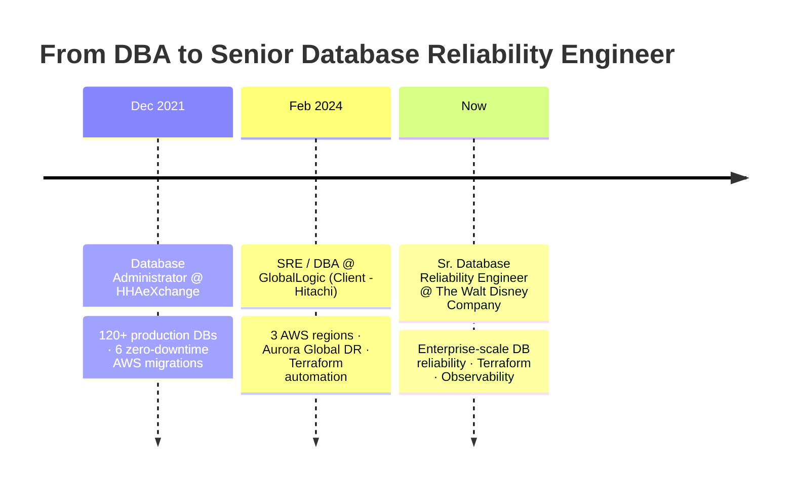
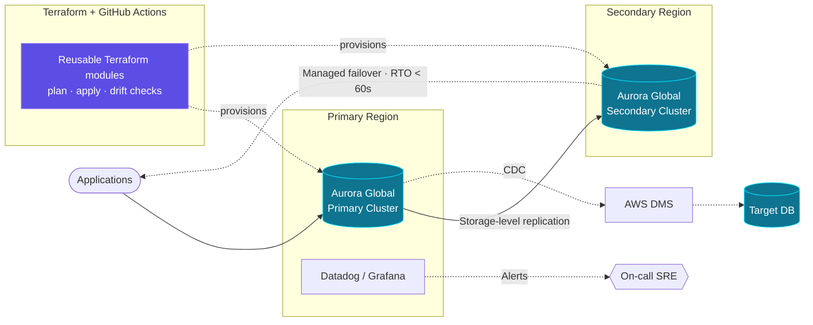

<!-- Dishant Modh — GitHub Profile README -->

<!-- ═══════════════ HEADER BANNER ═══════════════ -->
<p align="center">
  
</p>

<p align="center">
  
</p>

<p align="center">
  
  
  
</p>

<p align="center">
  <a href="mailto:dishantmodh7@gmail.com"></a>
  <a href="https://www.linkedin.com/in/dishant-modh-3334071a3/"></a>
  <a href="https://dishantmodh.com"></a>
  <a href="https://twitter.com/DishantModh"></a>
</p>

<p align="center">
  
  
  
  
</p>


## 👨‍💻 About Me

I'm a **Senior Database Reliability Engineer at The Walt Disney Company** with **5+ years** owning database infrastructure across distributed, cloud-native systems — from a healthcare-tech SaaS platform to enterprise-scale, multi-region deployments.

> 💬 *I don't just keep databases running — I make them **faster, cheaper, scalable and resilient.***

<table align="center">
<tr>
<td align="center" width="33%">⚡<br><b>Highly Available</b></td>
<td align="center" width="33%">🔄<br><b>Self-Healing</b></td>
<td align="center" width="33%">📈<br><b>Performance Optimized</b></td>
</tr>
<tr>
<td align="center">☁️<br><b>Cloud Native</b></td>
<td align="center">🏗️<br><b>Terraform / IaC First</b></td>
<td align="center">🌍<br><b>DR Ready</b></td>
</tr>
</table>


## 🧭 Career Journey




## 🏆 Engineering Impact

<table align="center">
<tr>
<td align="center" width="33%">
<h2>⏱️</h2>
<h3>8 min → &lt; 60 sec</h3>
<sub><b>RTO</b> · Aurora Global + AWS DMS</sub>
</td>
<td align="center" width="33%">
<h2>💰</h2>
<h3>$1.2M+</h3>
<sub><b>Annualized AWS savings</b></sub>
</td>
<td align="center" width="33%">
<h2>⚡</h2>
<h3>1.8s → 0.9s</h3>
<sub><b>P95 latency</b> · 40+ queries tuned</sub>
</td>
</tr>
<tr>
<td align="center">
<h2>🔭</h2>
<h3>45 → 31 min</h3>
<sub><b>MTTR</b> · Datadog + Grafana</sub>
</td>
<td align="center">
<h2>🤖</h2>
<h3>91% precision</h3>
<sub>ML anomaly detection · 87% recall</sub>
</td>
<td align="center">
<h2>🚚</h2>
<h3>4+ TB · 0 SLA breaches</h3>
<sub>6 zero-downtime migrations to AWS</sub>
</td>
</tr>
</table>


## 🌍 Architecture I Build: Multi-Region DR




## 🗄️ Database Expertise

```txt
PostgreSQL 14/15   ████████████████████  Expert
Aurora (PG/MySQL)  ████████████████████  Expert
MySQL 8            ████████████████░░░░  Advanced
MongoDB            ████████████████░░░░  Advanced
Cassandra          ██████████████░░░░░░  Advanced
Snowflake          ████████████░░░░░░░░  Proficient
Oracle             ████████████░░░░░░░░  Proficient
```

<details>
<summary><b>🔬 What I specialize in (click to expand)</b></summary>
<br>

| Area | Focus |
|---|---|
| 🐘 **PostgreSQL** | Query & index tuning · autovacuum tuning · partitioning · replication & HA |
| 🌍 **Reliability** | Multi-region DR · failover design · PITR backups · capacity planning |
| 🚚 **Migrations** | Zero-downtime moves to RDS/Aurora with AWS DMS |
| 🍃 **NoSQL** | MongoDB aggregation optimization · Cassandra data modeling |
| 🏗️ **Terraform / IaC** | Reusable DB modules · drift elimination · automated provisioning & patching |
| 🚨 **Operations** | P0/P1 incident response · post-mortems · runbooks |

</details>


## 🛠️ Tech Stack

<p align="center">
  
</p>

<details>
<summary><b>☁️ Cloud, IaC, Observability & Languages (click to expand)</b></summary>
<br>

| Category | Tools |
|---|---|
| **AWS** | RDS · Aurora · EC2 · DMS · Lambda · S3 · IAM · CloudWatch · VPC |
| **IaC & CI/CD** | **Terraform** · GitHub Actions · Jenkins · Octopus Deploy · Docker · Ansible |
| **Observability** | Datadog · Grafana · Prometheus · Loki · Alertmanager |
| **Languages** | Python · SQL · Bash · Go · PowerShell |

</details>


## 💼 Experience

### 🏰 The Walt Disney Company — Sr. Database Reliability Engineer
📍 India  ·  📅 [Mon YYYY] – **Present**

> Managing enterprise-scale distributed database workloads across **3 AWS regions**.

- 🌍 Run PostgreSQL, Aurora, MySQL, MongoDB, Cassandra & Snowflake clusters at **99.95%+ uptime**
- 🔄 Built multi-region DR architecture on **Aurora Global Database + AWS DMS**
- 🏗️ Build and own **Terraform** modules for RDS/Aurora provisioning, with plan/apply pipelines and drift detection
- ⚙️ Automated RDS provisioning & patching with **Terraform + GitHub Actions**
- 💰 Delivered **$1.2M annualized AWS savings** through infrastructure optimization
- 📊 Rolled out a centralized observability stack on **Datadog + Grafana**
- ⚡ Cut MongoDB & Cassandra query latency from **820ms → 450ms**
- 👥 Mentored junior SREs on PostgreSQL tuning & incident management

`PostgreSQL` `Aurora` `MySQL` `MongoDB` `Cassandra` `Snowflake` `Terraform` `AWS DMS` `GitHub Actions` `Datadog` `Grafana`

---

### 🏢 GlobalLogic *(Client: Hitachi)* — SRE / DBA
📍 Bengaluru  ·  📅 Feb 2024 – [Jul 2026]

> Managed enterprise-scale distributed database workloads across **3 AWS regions**.

- 🌍 Ran PostgreSQL, Aurora, MySQL, MongoDB, Cassandra & Snowflake clusters at **99.95%+ uptime**
- 🔄 Built multi-region DR architecture on **Aurora Global Database + AWS DMS**
- ⚙️ Automated RDS provisioning & patching with **Terraform + GitHub Actions**
- 💰 Delivered **$1.2M annualized AWS savings** through infrastructure optimization
- 📊 Rolled out a centralized observability stack on **Datadog + Grafana**
- ⚡ Cut MongoDB & Cassandra query latency from **820ms → 450ms**
- 👥 Mentored junior SREs on PostgreSQL tuning & incident management

---

### 🏥 HHAeXchange — Database Administrator
📍 Ahmedabad  ·  📅 Dec 2021 – Feb 2024

> Healthcare-tech SaaS platform serving **500K+ caregivers** with **120+ production databases**.

- 🐘 Administered PostgreSQL, MySQL, Cassandra & Oracle at **99.99% uptime**
- ⚡ Optimized **40+ slow PostgreSQL queries** using `EXPLAIN ANALYZE`
- 🚚 Executed **6 zero-downtime migrations** to AWS RDS/Aurora
- 🤖 Automated DBA operations with Python & Bash
- 🚨 Primary on-call DBA for P0/P1 incidents and post-mortems
- 🔧 Built Terraform modules & CI/CD validation pipelines


## 🚀 Featured Projects

<table>
<tr>
<td width="50%" valign="top">

### 🤖 [ml-dba](https://github.com/dhmodh/ml-dba)
ML anomaly detection platform built on PostgreSQL metrics.
**`91% precision`**

</td>
<td width="50%" valign="top">

### 🐘 [patroni-ha-cluster](https://github.com/dhmodh/patroni-ha-cluster)
Self-healing PostgreSQL HA cluster with Patroni + Terraform.
**`< 5s failover`**

</td>
</tr>
<tr>
<td width="50%" valign="top">

### 🧰 [postgres-dba-toolkit](https://github.com/dhmodh/postgres-dba-toolkit)
PostgreSQL monitoring & diagnostics toolkit.
**`Production-ready`**

</td>
<td width="50%" valign="top">

### 🏗️ [terraform-rds-modules](https://github.com/dhmodh/terraform-rds-modules)
Reusable Terraform modules for RDS provisioning.
**`Eliminated config drift`**

</td>
</tr>
</table>


## 🏅 Certifications

<p align="center">
  
  
  
  
</p>


## 🌱 Currently Working On

| | Focus |
|---|---|
| 🔌 | **PgBouncer** + PgBouncer Exporter integration |
| 📦 | **pgBackRest / Barman** PITR backup automation |
| 🤖 | **LSTM-based** anomaly detection for PostgreSQL |
| ☸️ | **Kubernetes-native** PostgreSQL operations |
| 🏗️ | Scaling **Terraform** DB platform modules |
| 📡 | Advanced observability pipelines |


## 📊 GitHub Analytics

<p align="center">
  
  
</p>

<p align="center">
  
</p>

<p align="center">
  
</p>

<p align="center">
  
</p>

<!-- Contribution snake (needs the snake.yml workflow — see setup notes) -->
<p align="center">
  <picture>
    <source media="(prefers-color-scheme: dark)" srcset="https://raw.githubusercontent.com/dhmodh/dhmodh/output/github-snake-dark.svg" />
    <source media="(prefers-color-scheme: light)" srcset="https://raw.githubusercontent.com/dhmodh/dhmodh/output/github-snake.svg" />
    
  </picture>
</p>


## 🤝 Let's Connect

<p align="center">
  Open to conversations about <b>database reliability, DR design, PostgreSQL performance, Terraform and cloud cost optimization.</b>
</p>

<p align="center">
  <a href="mailto:dishantmodh7@gmail.com"></a>
  <a href="https://www.linkedin.com/in/dishant-modh-3334071a3/"></a>
  <a href="https://dishantmodh.com"></a>
  <a href="https://twitter.com/DishantModh"></a>
  <a href="https://github.com/dhmodh"></a>
</p>

<p align="center">
  
</p>


